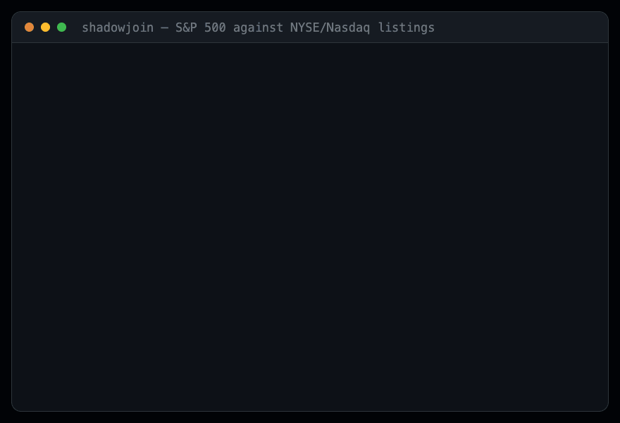

# shadowjoin

**Measure the matches your exact join is silently dropping.**

Your pipeline joins two sources on a name, an email, a SKU, a company. It matches
what matches. Everything else just... isn't there. No error, no exception, no
alert — the query returns, the dashboard renders, and a quarter of the rows that
should have matched quietly don't.

shadowjoin runs a shadow matcher alongside your real join key and tells you how
many matches you are losing, which normalization rule would recover each one, and
— if you have any ground truth at all — proves the recoveries are real.

```
npx shadowjoin scan \
  --left  customers.csv   --left-key  company_name \
  --right crm_export.csv  --right-key account_name
```

[](https://github.com/harsh-chandak/shadowjoin/blob/main/assets/brag.gif)

<sub>Fourteen seconds, no sound. Every figure in it is verbatim CLI output from
the committed example below — [higher-resolution
version](https://github.com/harsh-chandak/shadowjoin/blob/main/assets/brag.gif).</sub>

The progress output above is real: shadowjoin shows what it is doing while it
works. All of it is suppressed automatically when stdout is not a terminal, so
piping to a file, to `jq`, or running in CI produces byte-identical output to
before — and there is **no postinstall script**, because a tool you point at a
production database has no business running code at install time.

## What it found on public data

Joining the **S&P 500 constituent list** against **NYSE + Nasdaq listings** on
company name. Both files carry ticker symbols, so every recovered match can be
checked rather than believed:

```
  left rows 503   right rows 6,709

  exact join matches                1   0.2%
  recovered by shadow join        428   85.09%
  still unexplained                74

  LOWER BOUND ON LOST MATCHES: 85.09% of left rows
  verified against ground truth: 419 correct, 1 wrong, 8 ambiguous  (precision 99.76%)

  rules worth adopting, in order (greedy by marginal recovery):
  1.  strip security/listing boilerplate (common stock, ADS, ...)   +68       68
  2.  strip corporate suffixes (inc, corp, ltd, plc, gmbh ...)     +319      387
  3.  strip punctuation                                             +33      420
  4.  sort tokens (order-insensitive match)                          +4      424
  5.  remove all whitespace                                          +1      425
```

The exact join found **one** match. There were **four hundred and twenty-eight**,
and 419 of them are confirmed correct by ticker.

Reproduce it yourself — the data ships with the repo:

```bash
git clone https://github.com/harsh-chandak/shadowjoin && cd shadowjoin
npm install && npm run build
node dist/cli.js scan \
  --left  examples/sp500.csv    --left-key  Security --left-id Symbol --left-truth Symbol \
  --right examples/listings.json --right-key name    --right-id symbol --right-truth symbol
```

### A join you would actually ship

The example above is deliberately unflattering — a short index name against a
full security description. Here is the realistic case.

**Unicode CLDR country names** (what your UI displays) joined to **UN official
country names** (what your reference data uses), on the country name, with ISO
3166 alpha-3 as ground truth. That is a join people write every week.

```
  exact join matches              205 / 249   82.33%
  recovered by shadow join          5          2.01%   precision 100%
  still unexplained                39

  rules worth adopting:
  1.  & -> and                 +4
  2.  remove all whitespace    +1
```

It looks healthy. 82% matched, no errors, nobody investigating. And it is
silently dropping `Antigua & Barbuda`, `Trinidad & Tobago`,
`São Tomé & Príncipe`, `Turks & Caicos Islands` and `Vietnam` — the last one
because the UN spells it `Viet Nam`.

Two things this example shows that the first one does not:

**Applying every rule finds nothing.** The full rule set recovers zero here; the
two-rule subset recovers five. Over-normalization collapses keys that should stay
distinct, and shadowjoin names the better subset instead of letting you assume
more rules is better.

**It separates mechanical misses from semantic ones.** The 39 it cannot explain
are not normalization problems at all:

```
  Vatican City    vs  Holy See
  North Korea     vs  Democratic People's Republic of Korea
  Cape Verde      vs  Cabo Verde
  Bosnia          vs  Bosnia and Herzegovina
  Hong Kong       vs  China, Hong Kong Special Administrative Region
```

No string transform recovers those. They need an alias table or a real entity
resolution library. Knowing *which* of your misses are mechanical and which are
semantic is the difference between a one-line fix and a project.

```bash
node dist/cli.js scan \
  --left  examples/countries_ui.csv        --left-key  country --left-truth  iso3 \
  --right examples/countries_reference.csv --right-key country --right-truth iso3
```

> That particular join is deliberately unflattering — a short index name against a
> full security description. It is a worked example of the *measurement*, not a
> claim that anyone ships that join. Point it at your own data to get a figure
> that means something about you.

## The number is a floor, not an estimate

You cannot compute recall without labels. The entity-resolution literature calls
the metric **pair completeness**, and it assumes an oracle you do not have in
production.

So shadowjoin reports a **lower bound**: matches the shadow matcher found that
exact matching missed. The shadow matcher has unknown recall of its own, so the
true loss is *at least* this large and may be larger. Every figure ships with
sample pairs so a human can verify them by hand, and when ground truth is
available on both sides, the report carries a precision figure too.

This is deliberately the weaker claim. It is also the one that survives being
questioned.

## Why not just ask an LLM to check?

For a one-off look at a small table, do that — it is faster and this tool is
redundant. It stops working when:

- **You need the same number twice.** An agent writes different SQL every run, so
  you cannot tell whether the pipeline changed or the query did.
- **You need rules nobody thought of.** Asked "is this join lossy," an agent tries
  `lower()` and `trim()`. It does not systematically try NFKD folding, diacritics,
  leading zeros, corporate suffixes, token reordering or listing boilerplate. The
  exhaustive rule set *is* the product.
- **You need it in CI.** `--max-loss` exits non-zero. "Ask Claude" has no exit code.
- **Exploratory SQL on production is expensive.** This does hash joins on
  precomputed keys, under a statement timeout, in a read-only transaction.

## Install

```bash
npm install shadowjoin      # or run it with npx, no install
```

Zero runtime dependencies. `pg` and `@modelcontextprotocol/sdk` are optional
peers, pulled in only if you use the Postgres adapter or the MCP server.

## Use it

### CLI

```bash
# CSV or JSON, no database involved
npx shadowjoin scan --left a.csv --left-key name --right b.json --right-key title

# with ground truth on both sides, so recoveries are verified
npx shadowjoin scan \
  --left  a.csv --left-key  name  --left-truth  customer_id \
  --right b.csv --right-key title --right-truth customer_id

# straight at Postgres
npx shadowjoin scan \
  --left  'postgres://ro@host/db' --left-table  orders    --left-key  customer_name \
  --right 'postgres://ro@host/db' --right-table customers --right-key name

# in CI: fail the build if the floor climbs above 2%
npx shadowjoin scan --left a.csv --left-key name --right b.csv --right-key name --max-loss 2

# MySQL and SQLite work the same way
npx shadowjoin scan \
  --left  'mysql://ro@host/db' --left-table  accounts --left-key  company_name \
  --right ./reference.sqlite   --right-table vendors  --right-key name

npx shadowjoin rules     # list the normalization rules
```

**Sources:** CSV, JSON, Postgres, MySQL and SQLite. SQLite uses Node's built-in
`node:sqlite` (Node 22.5+), so it needs nothing installed; Postgres and MySQL
need `pg` or `mysql2`, which are optional peers.

**Anything else** works through the library in three lines, because the core
takes two arrays rather than a connection:

```js
import { scan } from "shadowjoin";
const [rows] = await anyDriver.query("SELECT id, company_name FROM accounts");
const left = rows.map((r) => ({ id: String(r.id), key: r.company_name }));
scan(left, right);
```

### Library

```js
import { scan, normalize, rulesByIds, toSql } from "shadowjoin";

const report = scan(leftRows, rightRows);        // rows are { id, key, truth? }
console.log(report.lowerBoundLossPct, report.stack);

// adopt the recommended rules in your own pipeline
const rules = rulesByIds(report.stack.map((s) => s.rule));
const key = (value) => normalize(value, rules);
toSql("company_name", rules);                     // the same thing as Postgres SQL
```

### Claude Code plugin (easiest)

One command installs the skill and the MCP server together, and prompts for your
config path:

```bash
claude plugin marketplace add harsh-chandak/shadowjoin
claude plugin install shadowjoin@harsh-chandak
```

Also listed in the [official MCP registry](https://registry.modelcontextprotocol.io)
as `io.github.harsh-chandak/shadowjoin`.

### MCP server

Lets an agent measure a join, look at real examples, propose a fix, and then
**prove the fix worked** — a loop it cannot fake, because the measurement is
not something it writes.

```json
{
  "mcpServers": {
    "shadowjoin": {
      "command": "npx",
      "args": ["-y", "-p", "shadowjoin", "-p", "@modelcontextprotocol/sdk", "shadowjoin-mcp"],
      "env": { "SHADOWJOIN_CONFIG": "/abs/path/to/shadowjoin.config.json" }
    }
  }
}
```

```json
{
  "sources": {
    "prod":  { "type": "postgres", "connectionString": "postgres://shadowjoin_ro@host/db" },
    "crm":   { "type": "csv",      "path": "./crm_export.csv" }
  }
}
```

Tools: `scan_join`, `explain_misses`, `suggest_normalization`, `compare_runs`.

**Two things this MCP server deliberately does not have:**

1. **No tool that executes arbitrary SQL.** An agent can name a configured source,
   a table and a column. That is the entire surface.
2. **No tool that accepts a connection string.** Credentials live in your config
   file and never enter a tool call, because tool calls end up in transcripts.

## Pointing it at a real database

shadowjoin opens a `READ ONLY` transaction with `statement_timeout`,
`lock_timeout` and `idle_in_transaction_session_timeout` set, and it **refuses to
run** if the role it connected with can write to the table it is about to read.

Give it a role that makes trust unnecessary:

```sql
CREATE ROLE shadowjoin_ro LOGIN PASSWORD 'xxx';
GRANT CONNECT ON DATABASE yourdb TO shadowjoin_ro;
GRANT USAGE  ON SCHEMA public    TO shadowjoin_ro;
GRANT SELECT ON public.orders, public.customers TO shadowjoin_ro;
```

Point it at a replica where you can.

**It makes no outbound network connection except to the source you give it.** No
telemetry, not even opt-out. Check the imports — there are three dependencies and
none of them is an HTTP client.

## Limits

Read these before quoting a number from it.

- **The figure is a floor.** The shadow matcher's own recall is unknown. True loss
  is at least this, possibly more.
- **Recoveries can be wrong.** In the bundled example, 1 of 428 was contradicted
  by ground truth and 8 were ambiguous — mostly share classes, where stripping
  "Class A" merges genuinely different securities. Ambiguous matches need a
  tie-breaker, not a normalization rule. Always read `samplePairs`.
- **Per-rule counts overlap and will not sum to the total.** Each is measured
  independently against the exact baseline, deliberately, so the numbers are not
  an artifact of the order rules happen to run in. Use `stack` — the greedy
  ordering — to decide what to actually adopt.
- **More rules is not better.** Applying every rule can recover *fewer* matches
  than the best subset, because over-normalization merges keys that should stay
  apart. shadowjoin warns when this happens and names the better subset.
- **It reads your join keys**, so those values are in memory while it runs.
  `--redact` hashes them in sample output and server-side normalization keeps
  whole rows in the database, but neither makes the keys invisible. For regulated
  data, run it on a replica inside your own environment.
- **It does not write, fix or migrate anything.** It measures.
- **`unaccent` in emitted SQL** needs the Postgres extension of the same name.

## Prior art

Blocking recall — *pair completeness* — is well established in the
entity-resolution literature, along with its companions pairs quality and
reduction ratio:

- [A Survey of Blocking and Filtering Techniques for Entity Resolution](https://arxiv.org/pdf/1905.06167)
- [Comparative Analysis of Approximate Blocking Techniques for Entity Resolution](http://www.vldb.org/pvldb/vol9/p684-papadakis.pdf)
- [Supervised Meta-blocking](http://www.vldb.org/pvldb/vol7/p1929-papadakis.pdf)

Those papers assume a labelled gold standard. shadowjoin's contribution is not the
metric — it is computing a defensible version of it against a live pipeline with
no labels at all, and reporting it as a bound rather than a point estimate.

For *doing* the matching rather than measuring what yours misses, use
[Splink](https://github.com/moj-analytical-services/splink),
[Dedupe](https://github.com/dedupeio/dedupe) or
[recordlinkage](https://github.com/J535D165/recordlinkage). shadowjoin is
complementary: it tells you whether you need them.

## License

MIT © Harsh N. Chandak
